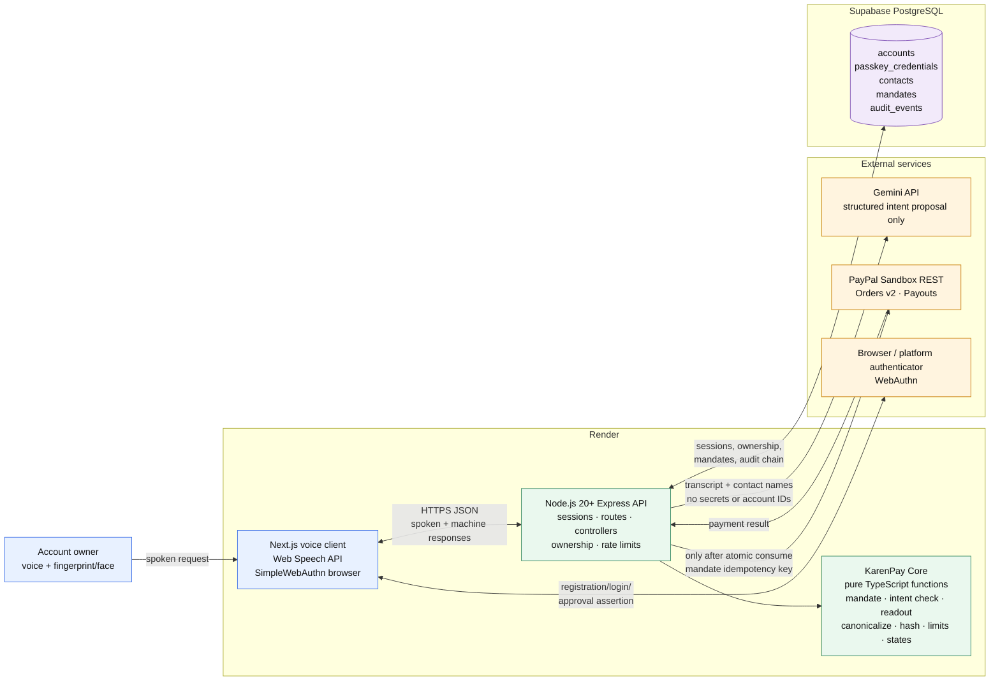
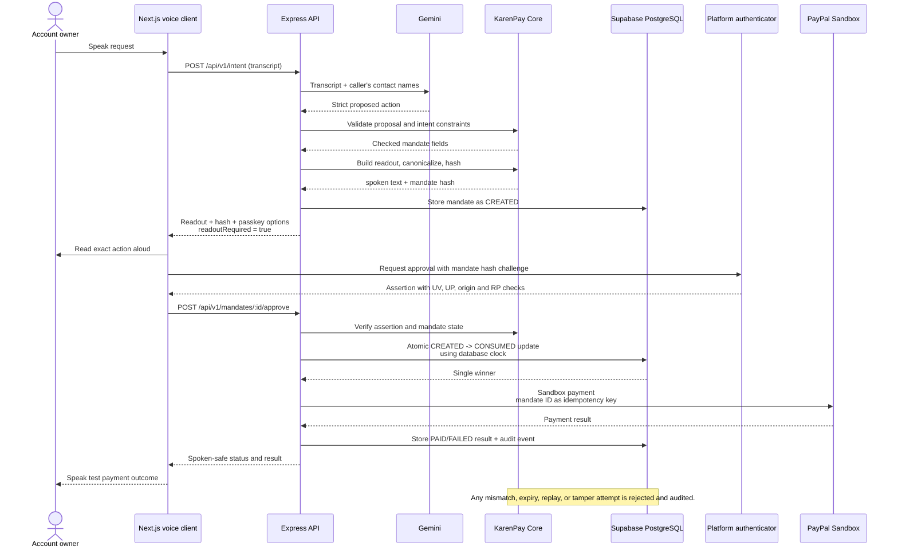
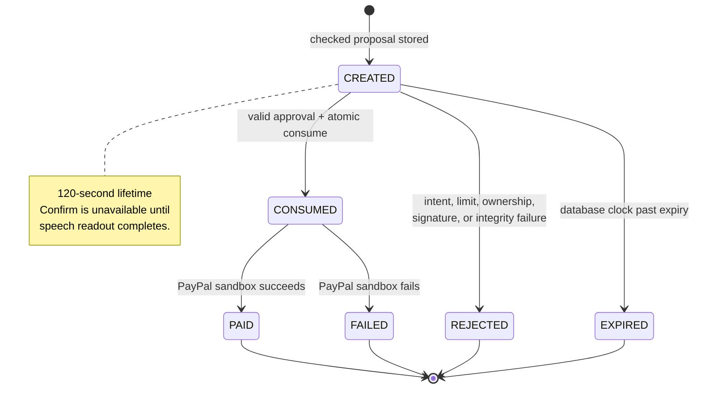

# KarenPay Architecture

KarenPay is a consent layer, not a bank, wallet, or payment processor. The
web client gathers a spoken request, KarenPay Core turns the approved action
into a tamper-evident mandate, and the API authorizes exactly one PayPal
sandbox payment after passkey approval.

## Runtime architecture

## Consent and payment sequence

## Mandate lifecycle

## Security-critical boundaries

- **Core has no I/O.** It receives time and data as inputs; it does not read
  clocks, access the database, call networks, or read environment variables.
- **Gemini proposes only.** Its structured output is validated, constrained to
  the caller's contacts, and checked against the original request. Gemini
  cannot approve, choose an outside recipient, or set the final amount.
- **The readout is hashed.** Spoken text is generated from the mandate's own
  fields, placed inside the canonical mandate, and included in the SHA-256
  challenge.
- **Approval is separate from login.** The approval assertion must have user
  verification and presence, matching origin and RP ID, a valid signature,
  and a challenge equal to the stored mandate hash.
- **Single use is transactional.** Only a guarded database update can move a
  mandate from `CREATED` to `CONSUMED`; repeated approvals return the stored
  result and never initiate another payment.
- **All outcomes are auditable.** Rejections, expiry, payment results, and
  security-relevant approval details are recorded in the hash-chained audit
  log.
- **PayPal is sandbox-only.** KarenPay holds no money and the API never sends
  credentials or secrets to the browser, Gemini, logs, or Git.
